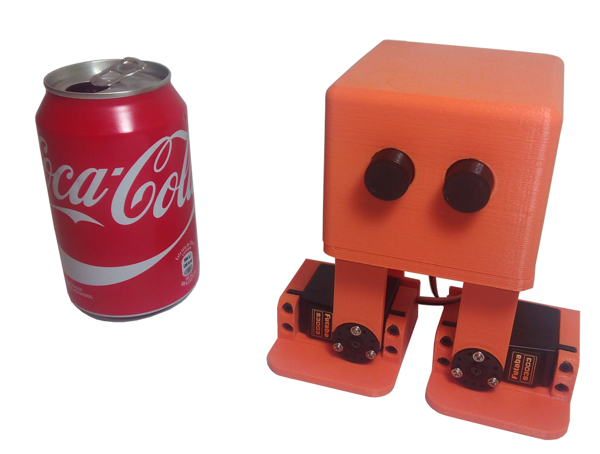
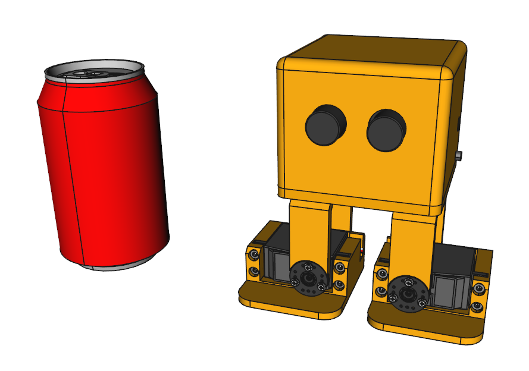
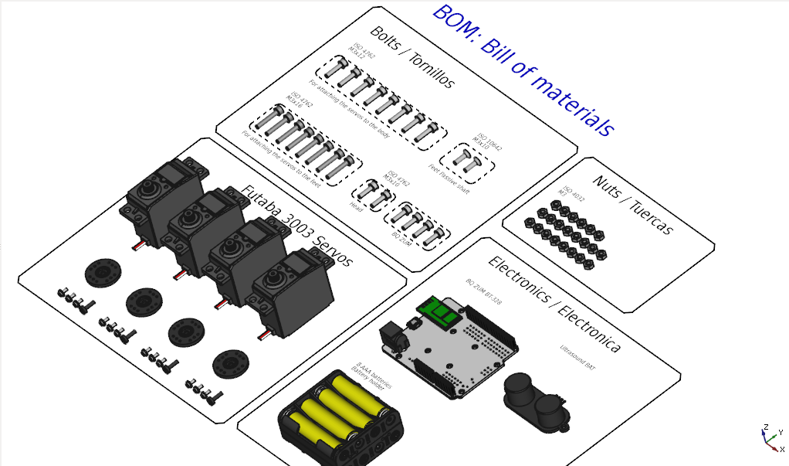
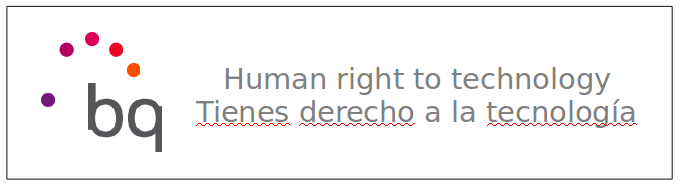

# ZOWI

In this repository you will find the source files for the **bq Zowi** robot. If you are missing something, please do not hesitate to [file an issue on github](https://github.com/bq/zowi/issues)

En este repositorio se encuentran los ficheros fuente del robot **Zowi de bq**. Si echas en falta algo, no dudes en [rellenar una tarea en github](https://github.com/bq/zowi/issues)

 

More information: [javierih.com/robots/zowi](https://javierih.com/robots/zowi/)

## Designed in Freecad

Zowi is not only an open source robot, but it has also been designed using the open source tool FreeCAD. This way, anyone can open the parts, study them, modify them and distribute the modifications

 

# Repository layout

Clone with `git clone --recursive` to get the ArduSnake submodule (or run `git submodule update --init`).

| Folder | Contents |
| --- | --- |
| [hardware/](hardware) | FreeCAD source, STEP and STL of the printed parts |
| [firmware/](firmware) | Zowi library, example sketches and the ArduSnake submodule (PlatformIO / Arduino IDE) |
| [mods/](mods) | Zowi mods made by the community |
| [sim/](sim) | URDF model, Isaac Sim / Isaac Lab, reinforcement learning and ROS 2 bridge |
| [legacy/](legacy) | Original Zowi app firmware and Protocoder remote controls, kept for reference |

# BOM: Bill of Materials

 

* 4 Futaba 3003 servos or compatibles
* 6 M3x10 Bolts (ISO 4762)
* 2 M3x10 Bolts (ISO 10642)
* 8 M3x12 Bolts (ISO 4762)
* 8 M3x16 Bolts (ISO 4762)
* 22 M3 nuts (ISO 4032)
* 1 BQ ZUM BT328 or Arduino
* 4 x 2 AAA Battery holder
* 8 AAA bateries

# License 

The hardware and documentation are licensed under a [Creative Commons Attribution-ShareAlike 4.0 International License](http://creativecommons.org/licenses/by-sa/4.0/) ([LICENSE](LICENSE)). The source code is released under the GPL ([LICENSE-GPL](LICENSE-GPL)).

El hardware y la documentación tienen una licencia [Creative Commons Attribution-ShareAlike 4.0 International License](http://creativecommons.org/licenses/by-sa/4.0/) ([LICENSE](LICENSE)). El código fuente se publica bajo la GPL ([LICENSE-GPL](LICENSE-GPL)).

Original concept by [k120189](http://www.thingiverse.com/k120189/about) on [Thingiverse](http://www.thingiverse.com/thing:43708)

# Other

Sponsored by BQ till march 2016
