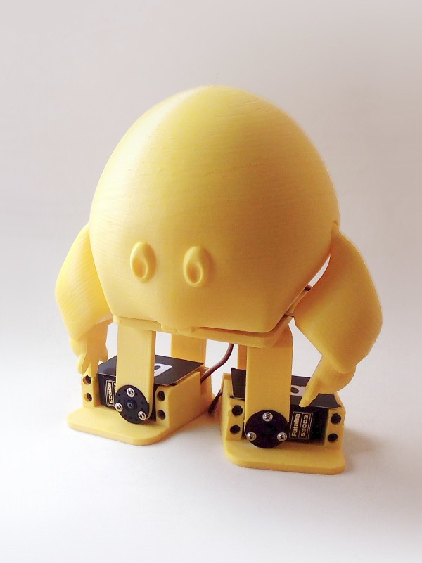
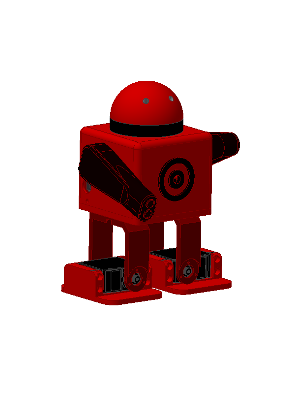
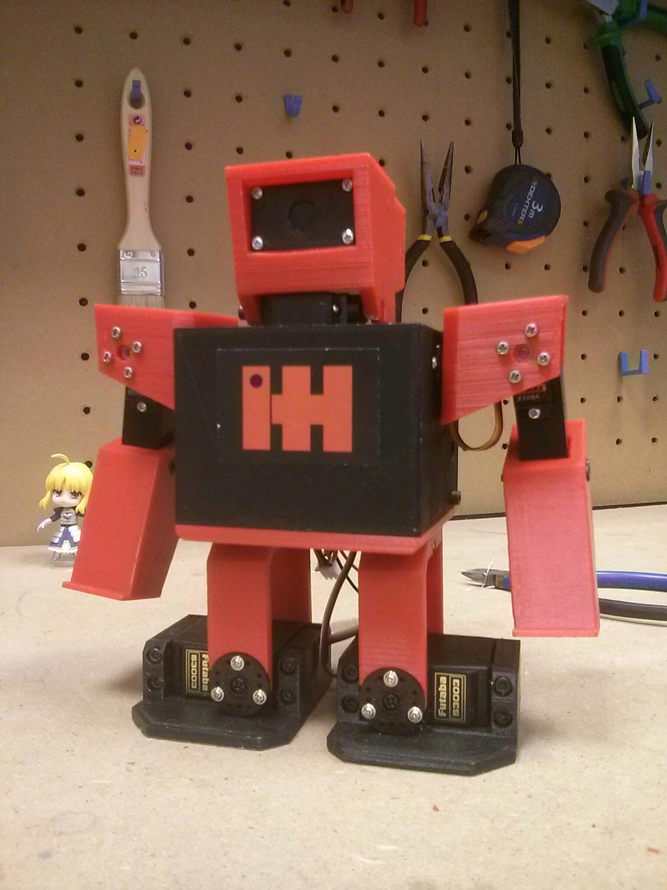
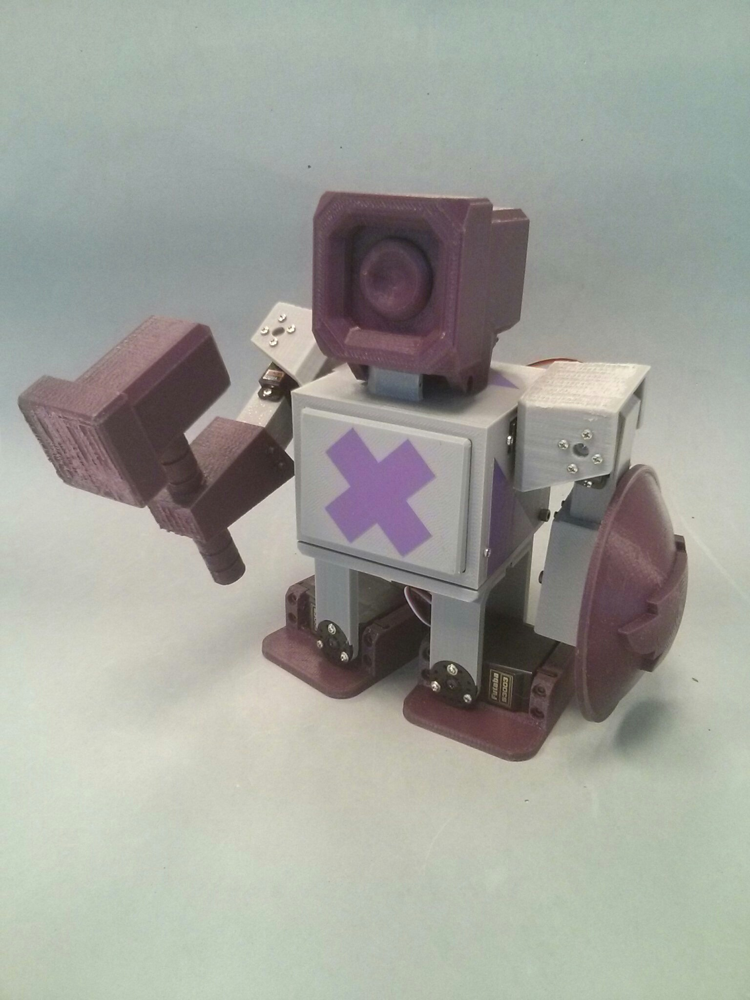
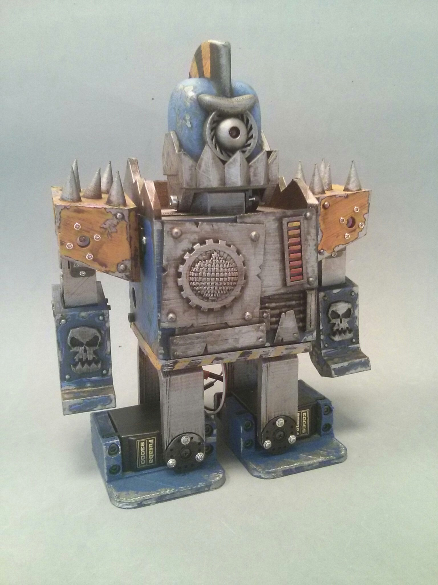
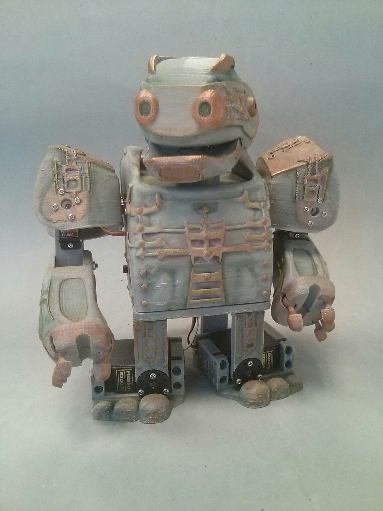
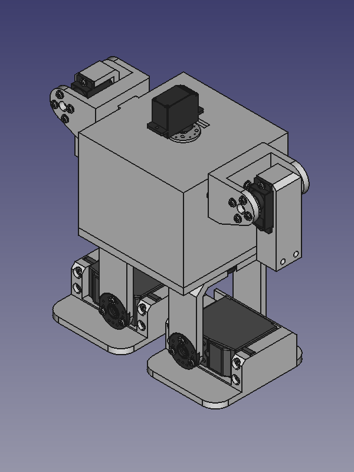
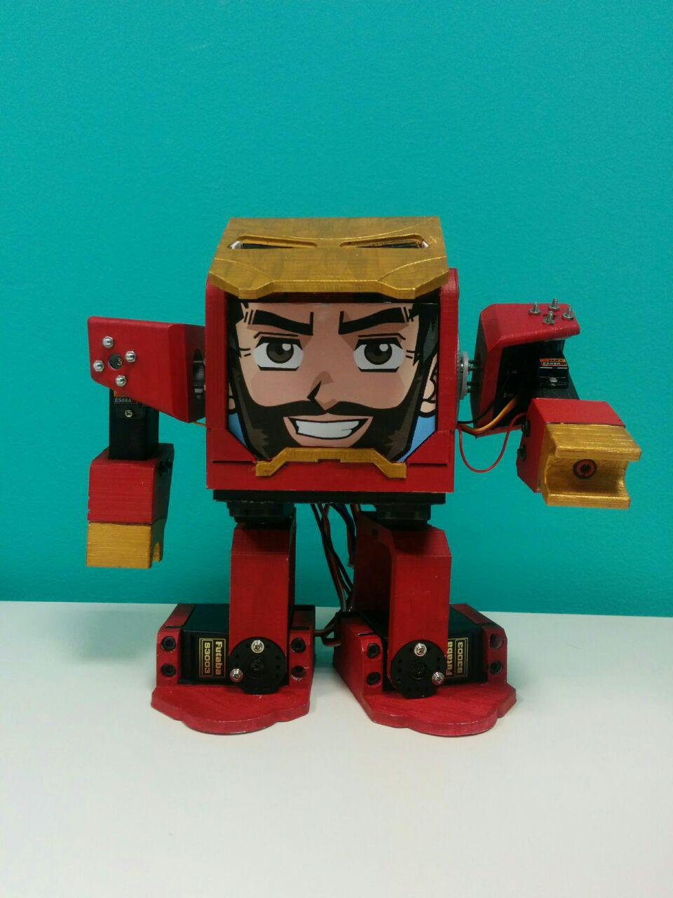

# Zowi mods

Each mod follows the same layout: `hardware/` (printable parts and CAD sources), `firmware/` (when it has its
own code) and `images/`.

| JIM | Scopum | Micro Raider |
| ------------- | ------------- | ------------- |
|  |  |  |
| By [Sonia Verdú](http://www.soniaverdu.es/) | By [Macarena González](https://github.com/MacarenaGB)| By  [Javier Isabel](https://github.com/JavierIH)|

| Forge | Zowiquilator | Kobuki |
| ------------- | ------------- | ------------- |
| |  |  |
| By [David Sánchez](https://github.com/davidsanfal) | by [Alberto Arribas](http://www.albertoarribasart.com/)  | By [Sonia Verdú](http://www.soniaverdu.es/) |

| Zowimanoid (template)| IronZowi | Zowarrior |
| ------------- | ------------- | ------------- |
|  | | (no picture yet) |
| By  [Javier Isabel](https://github.com/JavierIH) | By  [Gianluca Pugliese](https://github.com/owenlab) | |

## Firmware

The mods with a `firmware/platformio.ini` (Forge, IronZowi, Kobuki, MicroRaider, Zowiquilator) use the
Oscillator library from the ArduSnake submodule in [firmware/external](../firmware/external) (run
`git submodule update --init` first):

```
cd mods/Forge/firmware
pio run -t upload
```

Scopum keeps its own sketches for the Arduino IDE in `Scopum/firmware/`, and its Protocoder remote control in
`Scopum/protocoder/`.
